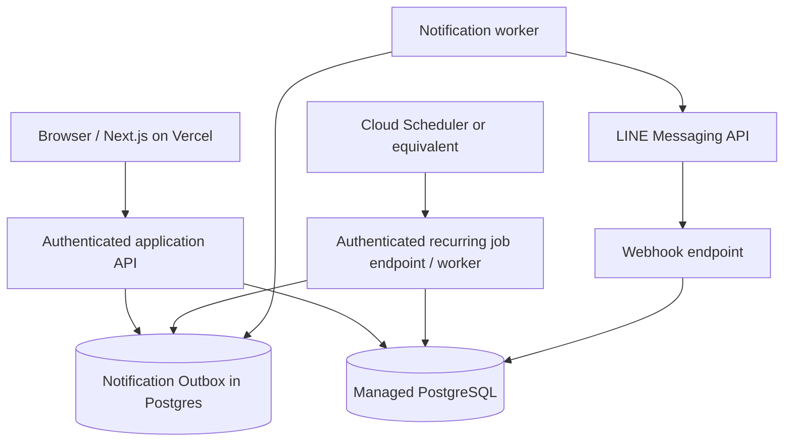

# SplitKub — MVP 3 & MVP 4 Implementation Plan

**Status:** Proposed; requires repository inspection and owner approval before implementation  
**Product:** SplitKub — one-time and recurring shared expenses  
**Target:** Extend the existing MVP 1–2 application, not a rewrite  
**Last updated:** 2026-10-17

## 0. Instructions for Codex Desktop (READ FIRST)

You are the Lead Engineer working in the existing SplitKub repository.

1. Inspect the actual repository, framework, dependencies, routes, deployment configuration, existing bill/group/share/payment models, and tests. **Do not assume** the current app is client-only or lacks a backend.
2. Produce an **as-is architecture summary** and a **gap analysis** against this document. Identify existing functionality to reuse and migrations required. Do not duplicate existing implementations.
3. Propose a concrete, file-by-file implementation plan with milestones, estimated complexity, data migrations, rollback strategy, risks, and explicit open questions.
4. **Do not modify files until the user approves the implementation plan.** Implement incrementally after approval.
5. For each milestone: implement, write unit/integration tests, run lint/typecheck/tests/build, independently review correctness/security/concurrency, document remaining concerns, and fix issues before continuing.
6. Do not introduce paid cloud services, provision infrastructure, deploy to production, enable outbound LINE messaging, or migrate production data without explicit approval.
7. Maintain a running `docs/implementation-progress.md`; finish with `docs/mvp3-mvp4-delivery-report.md` summarizing changed files, commands run, results, risks, configuration and rollout steps.

**Decision principle:** Simple, safe, observable, and inexpensive. No speculative microservices, Kafka, Redis, AI/OCR, or payment gateway.

---

## 1. Product goals and boundaries

### Existing functionality to preserve (verify in repository)
- One-time bill creation, editing, participants, per-item assignment and deterministic monetary splitting.
- Bill summary, PromptPay/QR display or upload, sharing.
- Existing group/shared bill features, if implemented.
- Fast anonymous one-time split; **do not force login for this flow**.
- Responsive Thai-first UI and existing design tokens/components.

### MVP 3 goals — Recurring Bills
- User can authenticate to own persistent groups, recurring templates and bill history.
- Owner creates a recurring template for monthly shared expenses (e.g. rent, streaming subscriptions, household bills).
- Template supports participants, fixed total, split policy, due day, timezone, start/end/pause, and designated collector.
- System automatically generates **one distinct bill instance per billing period**, safely across retries/concurrent jobs.
- Owner and members see what is owed and whether payment is pending, claimed, confirmed, or disputed.
- Owner can confirm receipt manually; **never represent a user claim as bank-verified payment**.
- Existing one-time flow remains usable without login; persistent collaboration requires access controls.

### MVP 4 goals — LINE OA
- Connect a SplitKub account/member identity to a LINE user identity with a secure consent flow.
- Notify eligible opted-in members when a bill is created and before/after due date.
- Notifications link to a secure personalized payment view, with amount and collector's PromptPay/QR.
- Member can mark "I've paid"; owner confirms or rejects. Notification preferences, unlink and quiet hours supported.
- Reliable message delivery workflow: idempotent events, queue/outbox, retries, rate limiting, quota guardrails, and audit logs.
- No automatic bank transaction verification or transfer of funds.

### Out of scope
Receipt OCR, AI, multi-currency, trip settlement, subscriptions/payment collection by SplitKub, bank integration, auto-confirmation from payment slips, native mobile app, advanced accounting, marketplace and monetization billing.

---

## 2. Delivery sequence and dependencies

| Milestone | Scope | Exit criteria |
|---|---|---|
| 0 — Discovery | Audit current repo and live flows; decide architecture | Approved design, verified current state, identified reuse |
| 1 — Identity & persistence | Auth, accounts, ownership, Postgres, migrations | Authenticated user can create/read owned persistent data; anonymous flow intact |
| 2 — Payment state | Collector, member balances, claims/confirmations, audit | Permissions and state transitions tested |
| 3 — Recurring templates | Create/edit/pause templates, monthly schedule | Correct next-run preview and validation |
| 4 — Recurrence execution | Scheduled generator, idempotency, backfill policy | Exactly one bill per template+period under concurrent/retry tests |
| 5 — Recurring UI | Dashboard, upcoming/overdue, detail and history | Mobile end-to-end acceptance passes |
| 6 — LINE account linking | OA setup, webhook verification, secure link/unlink | Verified user mapping and consent; no outbound blast |
| 7 — LINE reminders | Outbox, scheduled events, templates, retries, preferences | Test recipients receive expected notifications once per event |
| 8 — Production hardening | Monitoring, quotas, abuse limits, backups, rollout | Staging verified, production checklist approved |

**Recommended releases:** Ship MVP 3 after milestones 0–5; ship MVP 4 after 6–8. Gate each milestone with tests and owner review.

---

## 3. Architecture (proposed, subject to repo audit)



- Prefer **reuse of existing API/runtime**. If no backend exists, evaluate Next.js server routes versus Go API (e.g. Cloud Run); choose based on maintainability and hosting cost, not personal preference alone.
- PostgreSQL is the system of record; do not use localStorage for canonical recurring bills or payment states.
- Scheduler triggers authenticated work; database uniqueness and transactions provide idempotency. Scheduler timing is not the correctness guarantee.
- Use transactional outbox or an equivalent durable notification mechanism to avoid losing reminders between DB writes and LINE calls.
- Keep secrets server-side only. No LINE channel access token, database password, or webhook secret in browser bundles.
- Deployment choices, vendor-specific configuration, and pricing must be verified against current documentation before provisioning.

### Suggested repository modules (adapt to existing layout)

```text
src/ or app/
  features/auth/
  features/groups/
  features/bills/
  features/recurring/
  features/payments/
  features/line/
  lib/money/
  lib/time/
  lib/authorization/
  lib/notifications/
  db/migrations/
  jobs/
  tests/unit/
  tests/integration/
  tests/e2e/
docs/
```

Keep domain logic independent of UI, transport and cloud SDKs.

---

## 4. Domain model and proposed schema

**Inspect existing tables first.** Names below are logical examples, not a mandate to create duplicate tables.

| Entity | Key fields | Notes |
|---|---|---|
| `users` | id, display_name, created_at | Internal identity, optional email/auth provider |
| `auth_identities` | id, user_id, provider, provider_subject | Unique `(provider, provider_subject)` |
| `groups` | id, owner_user_id, name, created_at | Existing groups may be migrated |
| `group_members` | id, group_id, user_id nullable, display_name, role, status | Guest participants allowed; linking requires verified claim |
| `bills` | id, group_id nullable, collector_user_id, title, currency, total_satang, due_at, status, source_template_id nullable, period_key nullable | One-time and generated bills share a core model |
| `bill_items` | id, bill_id, name, amount_satang | Reuse existing split model |
| `bill_shares` | id, bill_id, member_id, amount_satang | Snapshot owed amounts per member; stable after issue |
| `payment_records` | id, bill_id, member_id, amount_satang, status, claimed_at, confirmed_at, confirmed_by | Manual payment tracking, not bank settlement |
| `payment_events` | id, payment_record_id, actor_user_id, event_type, metadata, created_at | Append-only audit trail |
| `recurring_templates` | id, group_id, owner_user_id, collector_user_id, title, amount_satang, currency, timezone, due_day, schedule_day, starts_on, ends_on nullable, status, split_policy, version | Validate day 1–31; document short-month behavior |
| `recurring_template_members` | template_id, member_id, weight or fixed_amount_satang | Snapshot to generated bill |
| `recurring_runs` | id, template_id, period_key, bill_id, status, created_at | Unique `(template_id, period_key)` |
| `line_links` | id, user_id, line_user_id, linked_at, revoked_at | Unique active LINE user mapping; encrypt sensitive data as appropriate |
| `notification_preferences` | user_id, enabled, timezone, quiet_hours, reminder_policy | Opt-in, unlink, suppression |
| `notification_outbox` | id, event_key, recipient_user_id, channel, payload_ref, status, attempts, next_attempt_at, provider_message_id nullable, last_error | Unique event key; payload minimization |
| `notification_attempts` | id, outbox_id, attempted_at, response_status, error_code | Avoid logging secrets and sensitive content |

### Database invariants
- Store THB amounts as **integer satang**. `sum(shares) == bill.total_satang` always; rounding deterministic.
- Unique `(template_id, period_key)` prevents duplicate generated bills; use transactional insert/upsert and row locking as needed.
- Unique member payment record per `(bill_id, member_id)` unless split into explicit installments (not in MVP).
- Only authorized owners/admins can edit recurring templates and confirm payments.
- A generated bill snapshots participants, allocations, due date, collector and template version; later template edits affect future periods only.
- Use UTC timestamps for storage and explicit `Asia/Bangkok` for Thai-local scheduling; store timezone per template.
- Soft-delete or archive where needed to preserve historical payment audit trails.

### Key unresolved schema decisions
- Whether anonymous bill links from MVP 2 can be claimed by an account; secure claim tokens and expiration are required.
- Whether one member may be in a group without a SplitKub account; if yes, define invitation/claim flow and access boundaries.
- Whether recurring bills have a single payer/collector or support multiple payers (recommend single collector for MVP).

---

## 5. Recurring business rules

### Template configuration
- Name, group, currency THB, total amount, participants, split method, collector, frequency `MONTHLY`, generation day, due day, timezone, start date, optional end date.
- MVP split methods: **equal** and **fixed amounts**. Weighted split can be a follow-up; never silently change existing split semantics.
- For day 29/30/31 in short months: **clamp to last day of month** (proposed default; confirm with owner).
- If due day precedes generation day, require explicit policy (recommend reject invalid schedule in MVP instead of silently rolling forward).
- Use local calendar month as `period_key` in `YYYY-MM`, derived in the template's timezone.
- Paused templates do not generate new periods. Resume must not automatically backfill old periods unless owner explicitly requests it.
- Template edits do not retroactively alter generated bills.

### Example
Template: `Netflix Family`, THB 419, four members, generation day 1, due day 5, timezone `Asia/Bangkok`.
On the first day of each month, generate one bill, split 41900 satang deterministically (e.g. 10475 each), set due date, and enqueue notifications for linked opted-in members.

### Scheduler and failure handling
1. Scheduler invokes protected job endpoint at least daily (more often only if needed).
2. Query active templates due for generation in the relevant local calendar period.
3. For each template, start a transaction, claim `(template_id, period_key)`, snapshot configuration, calculate shares, create bill, commit outbox events.
4. On conflict, treat as already generated; do not duplicate bill or notification.
5. Job can be safely retried and run concurrently.
6. Track skipped, failed, created and duplicate outcomes. Provide operator-safe manual retry and explicit backfill controls.

### Payment state machine

```text
UNPAID --> CLAIMED_PAID --> CONFIRMED
                 |              
                 +--> REJECTED --> UNPAID
UNPAID --> CANCELLED (owner/admin, audited)
```

- `CLAIMED_PAID` means member reported payment, **not** bank verification.
- Only collector/authorized owner can confirm/reject.
- Record who changed status, when and why; protect against double submit and stale state using optimistic concurrency or conditional updates.
- Overdue is a **derived label** based on due date and unconfirmed state, not necessarily a separate payment state.

---

## 6. API contracts (illustrative; adapt to existing conventions)

| Method | Route | Purpose | Authorization |
|---|---|---|---|
| `POST` | `/api/v1/recurring-templates` | Create template | Authenticated group owner/admin |
| `GET` | `/api/v1/recurring-templates` | List accessible templates | Authenticated member |
| `GET` | `/api/v1/recurring-templates/:id` | Detail + next scheduled bill preview | Authorized member |
| `PATCH` | `/api/v1/recurring-templates/:id` | Edit/pause/resume | Owner/admin |
| `GET` | `/api/v1/bills/:id` | Bill + shares + payment statuses | Authorized participant/owner |
| `POST` | `/api/v1/bills/:id/payments/:memberId/claim` | Member reports paid | Self or authorized delegate |
| `POST` | `/api/v1/bills/:id/payments/:memberId/confirm` | Collector confirms | Collector/owner |
| `POST` | `/api/v1/bills/:id/payments/:memberId/reject` | Collector rejects claim | Collector/owner |
| `POST` | `/internal/jobs/generate-recurring` | Generate due periods | Scheduler service identity only |
| `POST` | `/internal/jobs/dispatch-notifications` | Process outbox | Worker service identity only |
| `POST` | `/api/webhooks/line` | LINE events | Validated LINE signature |
| `POST` | `/api/v1/line/link/start` | Create expiring one-time link state | Authenticated user |
| `POST` | `/api/v1/line/unlink` | Revoke LINE mapping | Authenticated linked user |
| `PATCH` | `/api/v1/notifications/preferences` | Opt-in/out, quiet hours | Authenticated user |

### API conventions
- Server-side input validation, consistent error schema, pagination for lists, request IDs and safe logging.
- Verify authorization **on every resource access**; never trust a member ID, group ID or bill ID sent by the client.
- Apply CSRF protection where cookie-based auth is used; use secure HttpOnly cookies and session expiration.
- Rate-limit claim, link, webhook and job endpoints; never expose internal job endpoints publicly without strong authentication.
- Do not reveal PromptPay numbers, personal amounts or bill details to unauthorized users.

---

## 7. LINE OA integration design

### Setup checklist
1. Create/configure LINE Official Account and enable a Messaging API channel using the current LINE Developers workflow.
2. Store Channel Secret and Channel Access Token in server-side secret storage.
3. Configure HTTPS webhook URL and validate **`X-Line-Signature` using the exact raw request body** before processing.
4. Confirm actual LINE Login/account-linking capabilities and consent flow supported by the chosen channels; do not assume OA friendship alone identifies a SplitKub account.
5. Ensure member has added/not blocked the OA and is eligible for the intended message type. Respect current LINE platform policies and quotas.
6. Use staging/test recipients before enabling production messages.

### Identity linking
- User starts linking while authenticated in SplitKub.
- Generate short-lived single-use state/nonce bound to authenticated user and intended LINE identity flow.
- Complete a verified LINE authentication/account-link process; store verified `line_user_id` association, not a user-entered ID.
- Allow unlink/revoke and opt-out; handle block/unfollow and invalid recipients gracefully.
- Do not assume a group chat is the default channel; start with **1:1 notifications**. Group messaging is a separate later feature with additional permissions and UX.

### Notification events
- `bill.created` — once per recipient per bill.
- `bill.due_soon` — configurable, default 1 day before due date.
- `bill.overdue` — configurable, e.g. 1 and 3 days after due date, **only if not confirmed**.
- `payment.claimed` — notify collector; `payment.confirmed`/`payment.rejected` — notify member if opted in.
- Suppress reminders for confirmed payments, unlinked recipients, disabled notifications and quiet hours.
- Do not promise delivery: provider can fail, users can block OA, and messaging limits may apply.

### Outbox delivery
- Insert event records transactionally with bill/payment changes.
- Use unique event keys like `bill:{id}:due_soon:{memberId}:{dueDate}`.
- Worker claims pending events with locking, applies quota/rate limits, sends to LINE, stores outcome and retry time.
- Exponential backoff with jitter for retryable errors; terminal handling for invalid recipients and permanent failures.
- Avoid blind retries after ambiguous network outcomes: provider may have accepted a message. Where supported, use LINE's retry/deduplication request mechanisms and persist request IDs; otherwise explicitly document **at-least-once/possible duplicate delivery**.
- Define max attempts, dead-letter/manual review and operational alerts.
- Use concise Thai message templates and deep links to a secured bill view; avoid including unnecessary personal data in messages.

### Cost guardrails
- Estimate messages as `active_members × reminders_per_month`, plus bill creation and payment updates.
- Configure monthly cap and alert thresholds; skip/defer nonessential reminders when approaching quota.
- Verify **current Thailand LINE OA plan and Messaging API counting rules** before launch. Do not hardcode unverified prices or assume all messages are free.

---

## 8. UI / UX requirements

Preserve the established SplitKub design language: mobile-first, friendly, purple/indigo accent, accessible contrast, rounded cards, Thai-first copy, responsive desktop.

### Screens
1. **Home:** One-time Split (available) + Recurring Expenses (available after MVP 3) + LINE Reminders (available after MVP 4); avoid dead-end CTAs.
2. **Recurring dashboard:** Upcoming, unpaid, overdue, paid; amount due; group filter.
3. **Create recurring bill:** Stepper for title/amount → group/members → split → monthly schedule/due date → collector → review.
4. **Template detail:** Next billing date, status, members, history, edit/pause/resume.
5. **Monthly bill detail:** Breakdown per member, PromptPay/QR, status and claim/confirm actions.
6. **LINE settings:** Link/unlink, notification consent, reminder preferences and clear delivery caveats.
7. **Empty/error/loading states:** No groups, no linked LINE, disabled reminders, failed job, invalid bill link, expired invitation.

### UX principles
- Do not force account creation until user requests persistent or recurring features.
- Explain that member payment claims require owner confirmation.
- Show timezone and next-generation/next-due dates before saving a schedule.
- Use feature flags to hide incomplete features rather than showing nonfunctional screens.
- No fake payment verification or mock balances in production.

---

## 9. Security, privacy, reliability

- Data minimization: store only necessary identities, amounts, payment status, and LINE link metadata.
- Encryption in transit; encrypt secrets at rest; restrict DB credentials and service accounts to least privilege.
- Explicit opt-in for LINE reminders; visible unlink/delete-data path and documented retention policy.
- Signed/unguessable invitation and bill links; short expiry and revocation; prevent IDOR and enumeration.
- Validate uploaded QR image type/size and avoid public storage by default; never execute uploaded content.
- Backups and restore test for managed Postgres before production recurring schedules.
- Audit template edits, member changes, payment confirmations and notification sends.
- Timezone/DST-safe date calculations even if launch timezone is Thailand.
- Monitoring: job success/failure, generated bills, duplicates avoided, outbox backlog, send success/failure, cost/quota alerts, latency and DB health.
- Establish retention and deletion procedures consistent with applicable Thai PDPA obligations; obtain legal review if collecting more sensitive data or expanding payment features.

---

## 10. Testing plan

### Unit tests
- Integer satang calculations, equal/fixed allocation, rounding invariants.
- Schedule generation on days 28/29/30/31; leap years; local timezone boundaries; month/year rollover.
- Paused/resumed templates, start/end dates, invalid due/generation days.
- Payment state transitions, invalid transitions, stale updates.
- Notification eligibility, quiet hours, due-soon/overdue timing and suppression.

### Integration tests
- Transactional generation and unique `(template_id, period_key)` under concurrency.
- Scheduler retry and process crash recovery; no duplicate bill.
- Outbox insertion and dispatcher retries; webhook signature verification with raw body.
- Unauthorized access attempts to other groups/bills; invitation token misuse.
- Linking callback replay/expired nonce; unlink and blocked LINE account.
- DB migration forward and rollback on a staging copy.

### End-to-end tests
- Anonymous one-time bill still works.
- Authenticated owner creates group/template, sees next due date, generated monthly bill and balances.
- Member claims paid; owner confirms; overdue reminders stop.
- LINE-linked member receives test notification and opens authorized payment page.
- Responsive 375px, 390px, 768px, 1024px and desktop; keyboard and screen-reader labels.

### CI quality gates
`lint`, `typecheck`, `unit tests`, `integration tests`, `production build`, migration check and basic security/dependency scan. Use the repo's existing commands/toolchain where possible.

---

## 11. Rollout and operations

1. **Discovery:** inventory current hosting, source control, DB, auth, env vars, and existing user data. Record architecture decisions.
2. **Staging:** separate DB, secrets and LINE test channel/recipients; never send real user reminders from staging.
3. **Migrations:** versioned schema migrations with backup and rollback plan. Migrate existing groups/bills only if required and approved.
4. **Feature flags:** `recurring_enabled`, `line_linking_enabled`, `line_sending_enabled` default off in production until verified.
5. **Canary:** enable recurring for owner/test group; manually inspect two periods, idempotency and payment flow.
6. **LINE pilot:** opt-in test users only; verify quota, actual sends, failed deliveries and privacy.
7. **Launch:** enable progressively with usage dashboards and budget alerts.
8. **Runbook:** job failed, duplicate attempted, DB outage, LINE token expired, webhook signature errors, blocked users, quota exceeded.

### Environment variable examples (names illustrative)

```env
DATABASE_URL=
AUTH_SECRET=
APP_BASE_URL=
SCHEDULER_AUTH_AUDIENCE=
LINE_CHANNEL_SECRET=
LINE_CHANNEL_ACCESS_TOKEN=
LINE_LOGIN_CHANNEL_ID=
LINE_LOGIN_CHANNEL_SECRET=
RECURRING_ENABLED=false
LINE_LINKING_ENABLED=false
LINE_SENDING_ENABLED=false
```

Use secret manager/hosting environment settings; **never commit real credentials**.

---

## 12. Acceptance criteria / Definition of Done

### MVP 3
- Owner can create, edit, pause, resume and view monthly recurring templates.
- A template generates **at most one bill per period**, even under retries and concurrent job invocations.
- Generated bill shares sum exactly to bill total in satang.
- Authenticated authorized users can see their bills across devices; unauthorized users cannot.
- Member can claim paid and owner can confirm/reject with an audit trail.
- Existing anonymous one-time split is unaffected.
- Staging migration, backup/restore, CI checks and mobile E2E tests pass.

### MVP 4
- Member can securely link/unlink LINE and opt in/out of notifications.
- Bill-created, due-soon and overdue notifications are correctly targeted and suppressed after confirmation.
- Webhook signatures are verified, linking state cannot be replayed, and no LINE secrets reach client code.
- Retry, quota guardrails, logs and alerting are operational.
- Message content and destination links do not expose another member's private bill data.
- Owner verifies actual delivery in a controlled pilot; no claim of guaranteed delivery or automatic bank verification.

---

## 13. Questions Codex must raise before coding

1. What is the actual MVP 1–2 stack, deployed architecture and current persistent storage?
2. Is authentication already implemented? If not, preferred provider: LINE Login, email magic link, or Google? **Recommendation:** consider LINE Login for recurring users, but confirm product fit and integration complexity.
3. Do current group members have accounts, or are they name-only guests? How will they claim an identity securely?
4. Is there already a payment status flow or PromptPay QR generation logic to reuse?
5. Should recurring bills be generated on a separate generation day and due day, and what happens on short months?
6. Should all members see each other's balances or only their own?
7. Does the owner want a single collector per bill (recommended MVP) or multi-payer settlement?
8. Which cloud/database services are already provisioned, and what monthly budget ceiling is approved?
9. Which LINE OA/Messaging API channel is available, and who will handle configuration and test accounts?
10. How should legacy localStorage-only data be handled (leave local, optional import, or migrate)?

**Do not block repository inspection on these questions.** Propose reasonable defaults and explicitly request approval for decisions that materially affect data, cost or UX.

---

## 14. Copy-paste prompt for Codex Desktop

```text
Read SplitKub_MVP3_MVP4_Implementation_Plan.md carefully.
This is an existing production-bound SplitKub repository with MVP 1–2 implemented.

PHASE 1 ONLY — ANALYSIS, NO CODE CHANGES:
1. Inspect the actual repository, current features, dependencies, persistence, auth, routes and tests.
2. Compare current implementation with the MVP 3–4 plan.
3. Propose the smallest safe architecture that reuses existing code.
4. Produce a detailed implementation plan broken into independently testable milestones,
   including exact files/modules, DB migrations, API contracts, jobs, LINE linking,
   notification delivery, security, testing, rollout, rollback and estimated cloud costs.
5. List assumptions, unresolved product decisions, risks and recommended defaults.
6. Wait for my approval before modifying any code.

AFTER APPROVAL:
Implement one milestone at a time. Add tests, run the full relevant checks,
perform an independent review, fix findings, and summarize each milestone.
Do not provision paid services, deploy, send production LINE messages,
or change production data without my explicit approval.
```

---

## 15. Next-step recommendation

**Start with Milestone 0 — repo audit.** Do not create a new Go service or Postgres schema until Codex verifies what MVP 1–2 already contains. Then implement MVP 3 end-to-end before switching on LINE notifications. This minimizes rework and makes monthly reminders dependable.
